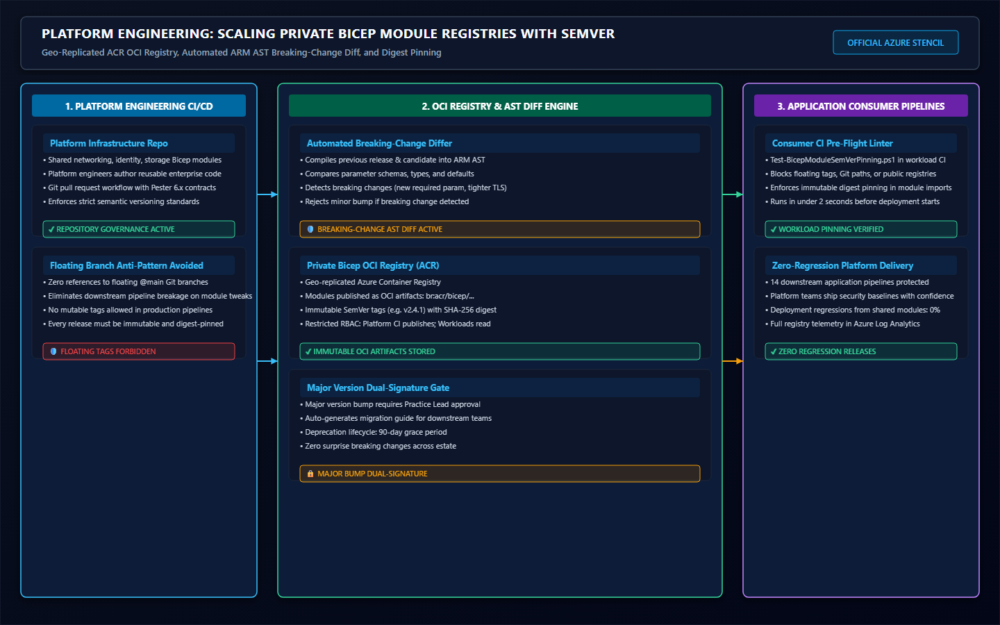
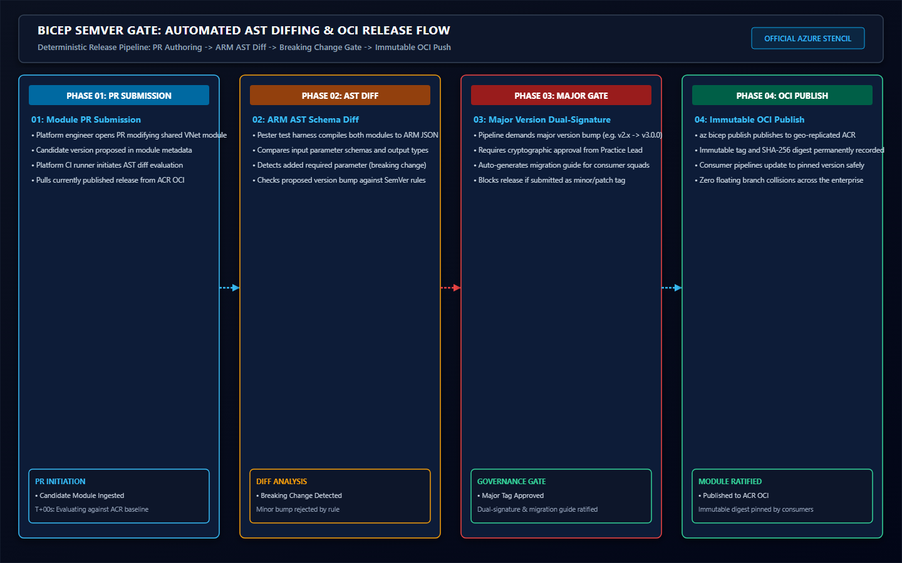

# PowerShell & ACR OCI Platform Module Registry Governance

**AI AST Breaking-Change Review, Strict SemVer 2.0.0 Pinning, Immutable ACR OCI Publishing & Microsoft Graph v2.x Dual-Signature Approvals**



---

## Executive & C-Suite Brief

### Business Risk & Supply-Chain Exposure
Enterprise platform teams rely on shared infrastructure and governance modules across dozens of Landing Zone subscriptions. Without automated Semantic Versioning (SemVer 2.0.0) enforcement and immutable artefact pinning, a single unannounced breaking parameter change—or a mutable `:latest` tag—can cascade across production pipelines, triggering **widespread deployment failures**, **uncontrolled configuration drift**, and **supply-chain audit findings**.

### Measurable ROI & Governance Outcomes
- **Zero Silent Breaking Changes**: Every module PR is parsed at the PowerShell Abstract Syntax Tree (AST) level before merge, blocking breaking changes disguised as `PATCH` or `MINOR` releases.
- **Immutable Supply Chain**: Enforces private Azure Container Registry (ACR) OCI SHA-256 digest verification and strict `X.Y.Z` pinning across `oci://` and `PSResourceGet` (`Install-PSResource`).
- **Executive & Security Accountability**: `MAJOR` version bumps automatically trigger a Microsoft Graph v2.x Teams Adaptive Card requiring dual-signature sign-off (Platform Architect + Security Reviewer) and optional SharePoint release logging.

---

## Chief Architect & Engineer Blueprint

### Epistemic & Control-Plane Boundaries
1. **100% PowerShell 7.4+ & REST/Graph**: Zero Bicep or Terraform stubs. Platform modules (`modules/network/vnet/Invoke-VnetBaseline.ps1`, `modules/security/keyvault/Invoke-KeyVaultBaseline.ps1`) and ACR OCI manifest pushes (`src/Publish-VerifiedBicepModule.ps1`) operate strictly via PowerShell 7.4+ and `Invoke-AzRestMethod`.
2. **Pinning Gate (`src/Test-BicepModuleSemVerPinning.ps1`)**: Scans consumer manifests and scripts, rejecting floating tags (`:latest`, `:main`, `:v1`, `:2.x`) and unapproved external registries.
3. **Immutable OCI Publish (`src/Publish-VerifiedBicepModule.ps1`)**: Pushes OCI v2 manifests (`application/vnd.oci.image.manifest.v1+json`) to private ACR, verifies SHA-256 digests, and holds `MAJOR` releases until dual signatures are present.



---

## AI Subcomponent & Pilot Grafting Guide

### AI Breaking-Change AST Reviewer (`ai/`)
- `ai/Invoke-ModuleBreakingChangeReview.ps1` + `ai/semver-ast-eval-cases.json` combine deterministic `System.Management.Automation.Language.Parser` AST inspection with optional Azure AI Foundry LLM semantic diffing:
  - Detects `REMOVED_PARAMETER`, `PARAMETER_TYPE_CHANGED`, `PARAMETER_BECAME_MANDATORY`, and `ADDED_MANDATORY_PARAMETER`.
  - Sanitises script comments against prompt-injection tokens before LLM summarisation.
  - Auto-generates caller migration notes in British English.

### Pilot Grafting Commands (PowerShell 7.4+ & Pester 6.x)

```powershell
# 1. Run the deterministic Pester 6.x verification matrix
Invoke-Pester -Path ./tests/BicepSemVer.Tests.ps1 -Output Detailed

# 2. Validate strict SemVer & PSResourceGet pinning
$manifest = "oci://acrsovereignmodules.azurecr.io/platform/network/vnet:2.5.0"
./src/Test-BicepModuleSemVerPinning.ps1 -ManifestContent $manifest

# 3. Run AI AST breaking-change review between v2.4.1 and v2.4.2
$base = Get-Content ./modules/network/vnet/Invoke-VnetBaseline.ps1 -Raw
$cand = $base -replace 'EnableDdosProtection', 'DdosPlanId'
$review = ./ai/Invoke-ModuleBreakingChangeReview.ps1 -ModuleName 'network/vnet' -PreviousVersion '2.4.1' -CandidateVersion '2.4.2' -BaselineScriptContent $base -CandidateScriptContent $cand

# 4. Dispatch Microsoft Graph v2.x Teams dual-signature card for MAJOR releases
./graph/Send-ModuleReleaseApproval.ps1 -AstReviewResult $review -TeamId '<team-guid>' -ChannelId '<channel-id>'
```

---

## Repository Structure

- `src/Test-BicepModuleSemVerPinning.ps1` — Strict `X.Y.Z` OCI & `PSResourceGet` pinning gate
- `src/Publish-VerifiedBicepModule.ps1` — ACR OCI REST manifest publisher & dual-signature gate
- `ai/Invoke-ModuleBreakingChangeReview.ps1` — PowerShell AST diffing + Foundry migration note generator
- `ai/semver-ast-eval-cases.json` — Foundry tool schema & 5-case AST evaluation benchmark
- `graph/Send-ModuleReleaseApproval.ps1` — Microsoft Graph v2.x Teams dual-signature Adaptive Card
- `modules/` — PowerShell 7.4+ platform baseline modules (`vnet`, `keyvault`)
- `queries/Acr-ModulePull-Telemetry.kql` — Log Analytics ACR pull & 401/403 telemetry
- `docs/SEMVER-GOVERNANCE-SPEC.md` — SemVer 2.0.0 & OCI governance specification
- `tests/BicepSemVer.Tests.ps1` — Pester 6.x verification matrix

---

## Microsoft Learn References

- [Azure Container Registry OCI Artifacts](https://learn.microsoft.com/en-us/azure/container-registry/container-registry-oci-artifacts)
- [PowerShellGet & PSResourceGet Overview](https://learn.microsoft.com/en-us/powershell/module/microsoft.powershell.psresourceget/?view=powershellget-3.x)
- [Semantic Versioning 2.0.0 & Azure Artifacts](https://learn.microsoft.com/en-us/azure/devops/artifacts/concepts/views?view=azure-devops)
- [Send Chat Message in Teams via Microsoft Graph](https://learn.microsoft.com/en-us/graph/api/channel-post-messages)
